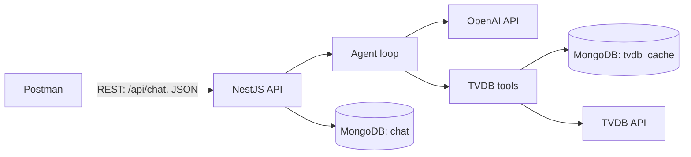

# Architecture

Design notes that the code doesn't make obvious, plus the design of what
isn't built yet. Hard rules are in CLAUDE.md, goals and decisions in
PLAN.md, TVDB endpoint behaviour in docs/TVDB_API.md.

## Implementation status

Built (read the code for details):

- `src/chat`: `POST /api/chat`, `POST /api/chat/:id/message` with
  `clientId` deduplication
- `src/agent`: OpenAI Agents SDK run with a structured final answer
  (`kind`, `message`, `sources`), grounding check with one correction round,
  fixed off-topic reply, history limit, turn deadline
- `src/tvdb`: client (login, token refresh, timeouts, retries), five tools,
  compact mappers
- `src/storage`: `ChatRepository` (Mongoose and in-memory), optimistic
  concurrency on `version`, `chat` collection
- `src/common`: retry helper, placeholder `AuthGuard` and `@UserId()`,
  `InternalErrorFilter`, request logging
- Limits and their defaults: `.env.example`

Not built yet: `GET`/`DELETE` endpoints and pagination, `TvdbCache`,
preferences, `summary`, `recommendations` and `metadata` on messages,
storing failed turns, the tool-free last step, Sentry, rate limiting on our
own API, movie support, grounding tests. Their design is below.

## Design notes

### Endpoints

| Method and path | Response | Status |
| --- | --- | --- |
| `POST /api/chat` | `201 { id, createdAt }` | Built |
| `POST /api/chat/:id/message` | `{ userMessage, assistantMessage }` | Built |
| `GET /api/chat` | `Paginated<ChatSummaryDto>`, newest first | Planned |
| `GET /api/chat/:id` | `ChatDto` (preferences, timestamps, no messages) | Planned |
| `GET /api/chat/:id/message` | `Paginated<MessageDto>`, newest first | Planned |
| `DELETE /api/chat/:id` | `204` | Planned |

- A chat owned by another user returns `404`, not `403`, so its existence
  isn't revealed. Chats are never created implicitly.
- The chat id is always explicit in the URL, never inferred ("latest
  chat"): with the placeholder user id every request looks like the same
  user, so a guess would mix conversations.
- Plain REST, no streaming. If the client disconnects, the turn still
  completes and is saved; the client recovers it via
  `GET /api/chat/:id/message`. SSE can be added in the controller later
  without touching services.
- Retry rules for a repeated `clientId`: answer saved → return it; turn
  still running → say so; previous answer `failed` (planned) → rerun the
  turn for the existing user message.

### Pagination

One mechanism for every listing endpoint (not built yet):

- `PaginationQueryDto` (`limit`, opaque `cursor`), `Paginated<T>`
  (`{ items, nextCursor }`, `null` on the last page) and cursor
  encode/decode live in `src/common` and never import Mongoose, so
  controllers and services can use them.
- A generic Mongoose `paginate<T>(model, filter, { limit, cursor,
  sortField })` and an in-memory twin live in `src/storage`.
- Keyset pagination: sort on the field plus `_id` as tie-breaker, fetch
  `limit + 1` to detect a next page. It stays correct while new chats and
  messages arrive and uses an index instead of skipping.
- The cursor comes from the client: decoding checks shape and value types
  before it reaches a query; a bad cursor is a `400`.

TVDB's own `page` parameter inside tools is unrelated.

### Grounding

What code guarantees, and what still relies on the prompt:

- Every cited id must be in the turn's registry (entities returned by tools
  this turn plus earlier validated sources). The registry is rebuilt each
  turn, never stored.
- Planned: `Source` and `Recommendation` fields (name, year, network, …)
  are copied by code from tool results; the model only writes `reason`.
- Limitation: free `text` can't be fully checked. The prompt forbids
  naming series outside sources and recommendations; the tests below catch
  regressions.

#### Verifying answers come from TVDB

Planned tests:

- **Fictional fixtures**: a fake TVDB returns data that differs from the
  real world; the answer must repeat the fixture, not the real facts.
- **Empty TVDB**: nothing returned for a well-known series (e.g. Breaking
  Bad); the answer must be `not_found`.
- **Sample queries** (real model, not in CI): the PLAN.md queries with
  recorded fixtures; every cited id must appear in the tool results.

### Rate limiting and retries

Implemented in `src/common/retry.ts`. Non-obvious choices:

- A `Retry-After` longer than the cap fails immediately instead of blocking
  the turn.
- A TVDB `401` is one re-login and one retry in the client, not the backoff.
- The OpenAI SDK's own retries are configured instead of wrapping it.
- When retries run out, TVDB serves a stale cache entry if there is one
  (planned), otherwise a short tool error; never invented data.

Planned: rate limiting on our own API (per IP, later per user) with `429`
and `Retry-After`.

### Timeouts

Each turn has one `AbortController` firing at the turn deadline; its signal
reaches every TVDB request, the retry backoff and the OpenAI call, combined
with each smaller timeout. On a timeout, only the user message is kept;
nothing unvalidated is saved. Planned: at the step limit, one last step
without tools to answer from what was found, or `not_found`.

### Data model

#### Mongoose conventions

- Entities, DTOs and responses use a string `id`; `_id` and `__v` never
  leave the store. Keeps MongoDB out of the API, lets the store be swapped,
  and avoids `ObjectId` comparison bugs.
- Each schema sets `collection` explicitly; no auto-pluralization.

#### Planned chat fields

- `preferences`: TVDB references (`{ tvdbId, name }`) for liked/disliked
  series, genres and companies, written only by an `update_preferences`
  tool with ids from the registry. Never free text, so preferences can't
  carry injected instructions.
- `summary`: model-written context for the next turn. Untrusted and
  length-limited, never a source of facts or ids, never returned.
- `recommendations` on assistant messages: "the second one" and "already
  recommended" are derived from them, not stored separately.
- `metadata` (tool call log, token usage): internal only, never returned or
  sent to the model.

#### `tvdb_cache` collection

One collection for all endpoints, one document per request; only the TTL
differs per entry.

- `_id` is the cache key: path plus validated params, sorted and encoded,
  defaults included; never the token. `/login` and errors (incl. `404`) are
  not cached.
- Stores raw TVDB `data`, not the compact tool output, so mapper changes
  need no flush and entries match `test/fixtures/tvdb/samples/`.
- `freshUntil` decides hits; the TTL index is on `deleteAfter`
  (`freshUntil` + stale grace), so stale entries survive to be served
  when TVDB fails.
- Layers: tool → TVDB client → `TvdbCache` (`get`, `getStale`, `set`) →
  `MongoTvdbCache` or `InMemoryTvdbCache`.

| Group | Requests | Default TTL | Config |
| --- | --- | --- | --- |
| Reference | `/genres`, `/series/statuses`, `/search?type=company` | 7 days | `TVDB_CACHE_TTL_REFERENCE` |
| Records | `/series/{id}`, `/series/{id}/extended`, `/people/{id}/extended`, `/companies/{id}` | 24 hours | `TVDB_CACHE_TTL_RECORD` |
| Lists | other `/search`, `/series/filter` | 1 hour | `TVDB_CACHE_TTL_LIST` |
| Stale grace | added to `freshUntil` | 7 days | `TVDB_CACHE_STALE_GRACE` |

### Observability (Sentry)

Planned; disabled without `SENTRY_DSN`.

- Errors with tags (`turnId`, `chatId`, service, limit hit, step count).
- One trace per turn with spans for agent steps, OpenAI calls, tool calls
  and TVDB requests (cache hit or miss); token counts as span attributes.
- Counts of grounding rejections, `not_found`, `off_topic` and
  validation failures.
- Scrub keys, the TVDB PIN and `Authorization` in `beforeSend`; no default
  PII.

## Future work

- JWT in `AuthGuard` (verify, `401`, user id from `sub`), read by `@UserId()`
- SSE streaming
- Long-term memory across chats (`users` collection, with "forget me")
- Prompt caching for the system prompt and tool definitions
- Evaluation set of sample conversations
