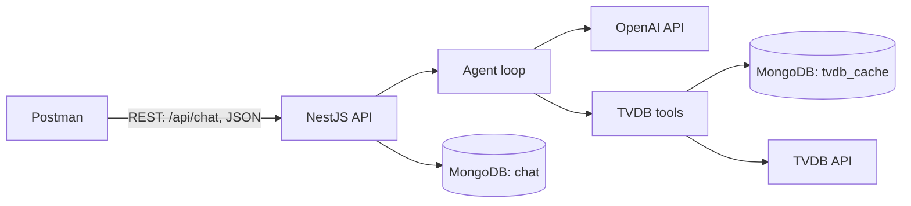

# Architecture

This document describes the design of the chatbot: what is built and what is planned.

## Implementation status

The sections below describe the full design. Built so far:

- `POST /api/chat` and `POST /api/chat/:id/message` (with `clientId`
  deduplication), Zod validation, placeholder `AuthGuard` and `@UserId()`,
  generic 500s through `InternalErrorFilter`, request logging
- AgentModule on the OpenAI Agents SDK: structured final answer, grounding
  check with one correction round, fixed off-topic reply, history limit,
  turn deadline
- TvdbModule: client with login, token refresh, timeouts and the shared retry
  helper; five tools; compact mappers
- StorageModule: `ChatRepository` with Mongoose and in-memory
  implementations, optimistic concurrency, `chat` collection
- Docker Compose (MongoDB 7 and the API in watch mode), tests, logging

Designed but not built yet: the `GET`/`DELETE` endpoints and the shared
pagination (`PaginationQueryDto`, `Paginated<T>`, `paginate`), the
`tvdb_cache` collection and `TvdbCache`, preferences, `summary`, structured
`recommendations` and `metadata` on messages, storing failed turns, the
last tool-free step at the step limit, Sentry, rate limiting on our own API,
movie support, and the fictional/empty-fixture and sample-query tests.

## Design



Everything runs with `docker compose up`: the NestJS API and MongoDB.
There is no UI; the API is called with Postman.

### Modules

- **ChatModule**: REST endpoints; returns the answer as one JSON response
- **AgentModule**: the tool-calling loop, system prompt and grounding check;
  built on the OpenAI Agents SDK (`@openai/agents`). The agent's output
  type is the final-answer schema (`kind`, `message`, `sources`), so a turn
  can only end with a validated answer; tracing to OpenAI is disabled
- **TvdbModule**: TVDB client (login, token refresh), tools and mappers
- **StorageModule**: `ChatRepository` and `TvdbCache` interfaces with MongoDB
  implementations; in-memory implementations for tests; the storage side
  of pagination (the Mongoose `paginate` helper and its in-memory
  counterpart)
- **CommonModule**: shared building blocks used across modules, including the
  storage-agnostic pagination contract (`PaginationQueryDto`,
  `Paginated<T>`, cursor encoding). It depends on no other module and
  never imports Mongoose

### Layers

Each module follows the NestJS convention of controllers, services and
repositories:

- **Controllers** handle HTTP only: routes, DTO validation (through the
  global validation pipe), the user id from `@UserId()` (later the auth
  guard), and mapping results to JSON responses. No business
  logic and no database access.
- **Services** hold the business logic (agent loop, grounding check, TVDB
  tools, preferences). They don't know about HTTP requests or MongoDB.
- **Repositories** connect to data sources such as MongoDB. The
  `ChatRepository` and `TvdbCache` interfaces are the repositories; their Mongoose
  implementations are the only code that uses MongoDB, and the in-memory
  implementations are used in tests. Services depend on the interfaces,
  injected by NestJS.

Calls only go one way: controller → service → repository. The TVDB HTTP
client is wrapped the same way, as a client the services call.

### REST API, no streaming

For simplicity the API is plain REST with JSON, without streaming (no SSE
or WebSockets). `POST /api/chat/:id/message` runs the whole agent turn and returns the
final answer, recommendations and sources in one response once the turn
ends.

- The request stays open for the whole turn, bounded by the turn deadline
  (see Timeouts). The client (Postman) waits for the
  response; there are no progress or partial-answer events.
- Errors (timeout, OpenAI API failure) are returned as normal
  HTTP error responses with a short message, not as stream events.
- Unexpected errors return a generic `500 Internal server error`. A global
  `InternalErrorFilter` keeps error details, stack traces and upstream
  responses out of the response and logs only the error's stack.
- If the request drops, the turn still completes and is saved; the client
  gets it via `GET /api/chat/:id/message` (see Message ids).
- Streaming (SSE) can be added later in the controller without changing the
  services, since the agent loop already ends in one validated answer (see
  Future work).

### Endpoints

| Method and path | Input | Response | Notes |
| --- | --- | --- | --- |
| `POST /api/chat` | none | `201 { id, createdAt }` | Creates an empty chat owned by the `@UserId()` user |
| `POST /api/chat/:id/message` | body `{ text, clientId? }` | `{ userMessage, assistantMessage }` (`MessageDto`) | Runs one agent turn; retry rules in Message ids apply |
| `GET /api/chat` | `PaginationQueryDto` | `Paginated<ChatSummaryDto>` | The user's chats, newest first |
| `GET /api/chat/:id` | none | `ChatDto` | Preferences and timestamps; no messages |
| `GET /api/chat/:id/message` | `PaginationQueryDto` | `Paginated<MessageDto>` | Message history, newest first; also how a dropped turn is recovered |
| `DELETE /api/chat/:id` | none | `204` | Chats are kept until explicitly deleted |

Rules for every `:id` route:

- `:id` is validated by a path-param DTO; an invalid format returns `400`.
- The chat must belong to the `@UserId()` user. Otherwise the response is
  `404`, not `403`, so it doesn't reveal that the chat exists.
- A message for an unknown chat returns `404`; chats are never created
  implicitly.

The chat id is always explicit in the URL, never inferred (e.g. "the
user's latest chat"). Until JWT is added every request has the same
placeholder user id, so inferring would silently put messages into the
wrong conversation, with its history and preferences. `clientId`
deduplication also only works within a known chat.

### Pagination

Every listing endpoint is paginated (e.g. `GET /api/chat`,
`GET /api/chat/:id/message`). The mechanism is written once and reused
for every entity; no endpoint implements its own paging.

The mechanism is split by whether a piece needs Mongoose:

| Piece | Module | Used by |
| --- | --- | --- |
| `PaginationQueryDto`, `Paginated<T>`, cursor encode/decode | CommonModule | Controllers, services, repositories |
| Mongoose `paginate<T>` helper | StorageModule | MongoDB repository implementations |
| In-memory paginate helper | StorageModule | In-memory repository implementations (tests) |

The contract has no MongoDB dependency, so controllers and services can
use it without breaking the layering, and the Mongoose rule (only the
`ChatRepository` and `TvdbCache` implementations import Mongoose) holds.
Dependencies go one way: ChatModule → CommonModule and StorageModule →
CommonModule.

- **Request**: one shared query DTO, `PaginationQueryDto`, with `limit`
  (default and maximum enforced by validation) and `cursor` (opaque, taken
  from the previous response).
- **Response**: one generic envelope, `Paginated<T>`:
  `{ items: T[], nextCursor: string | null }`. `nextCursor` is `null` on the
  last page.
- **Cursor**: encoded and decoded by one helper in CommonModule, so both
  storage helpers produce and accept the same opaque format. The cursor
  comes from the client, so decoding checks its shape and value types
  (sort value and id only, no objects) before anything reaches a MongoDB
  query; a malformed or tampered cursor is a validation error (`400`).
- **Storage**: one generic Mongoose helper, e.g.
  `paginate<T>(model, filter, { limit, cursor, sortField })`, used by every
  MongoDB repository. It sorts on a stable key (sort field plus `_id` as
  tie-breaker), fetches `limit + 1` documents to know whether a next page
  exists, and encodes the last item's key as the cursor. An in-memory
  helper next to it applies the same rules to arrays, so the in-memory
  repositories for tests behave the same.
- **Adding a new listing endpoint** means accepting `PaginationQueryDto`,
  calling the repository's paginated method and returning `Paginated<T>`.

Cursor-based (keyset) pagination is the default because it stays correct
while new documents are inserted (new chats and messages arrive
constantly) and uses an index instead of skipping documents. Page/limit is
the alternative if numbered pages are needed by the client.

Pagination of TVDB results inside tools is separate: TVDB uses its own
`page` parameter, and tools return compact, size-limited results to the LLM.

### Input validation and sanitisation

Every input is validated and typed before it reaches a handler, following
the [NestJS validation docs](https://docs.nestjs.com/application/validation):
DTOs are Zod schemas, and Nest's `StandardSchemaValidationPipe` is
registered globally in `main.ts`.

- Each endpoint declares a Zod schema for its query, path params and body
  and binds it with `@Body({ schema })`, `@Query({ schema })` or
  `@Param('id', { schema })`; the DTO type is `z.infer<typeof schema>`.
  The handler receives the parsed output (trimmed, coerced, defaults applied).
- Values are converted to their declared type and checked: a numeric query
  parameter must be a number within its range (e.g. `limit`), ids must match
  their format, enums must be one of the allowed values. Invalid input
  returns `400` with a clear message.
- Unknown fields are rejected: body and query schemas use
  `z.strictObject`, so clients can't send extra properties that end up in
  the database or the prompt.
- Strings are trimmed and length-limited; control characters are stripped.
  The chat message has a maximum length.
- MongoDB queries are built only from validated values, never from raw
  request objects, so operators like `$gt` can't be injected.

### User identity (no authentication)

Full authentication is out of scope for now. Handlers still need
a user id (e.g. to own chats), so it comes from one parameter decorator,
`@UserId()`, and nowhere else:

- Every route requires authentication: a global `AuthGuard` (`APP_GUARD`)
  runs on every request. For now it is a placeholder that lets every
  request through.
- For now the decorator returns a fixed placeholder user id; it reads
  nothing from the request.
- TODO in the guard: verify a JWT from the `Authorization` header
  (signature, expiry, issuer, audience), reject missing or invalid tokens
  with `401` and store the user id from the token's `sub` claim on the
  request, where `@UserId()` reads it.
- Handlers never read user ids from headers, query or body, so adding real
  authentication later only changes the decorator (plus a guard), not the
  handlers.

### Topic restriction

The bot only answers questions related to TV series and movies (shows,
cast, genres, networks, streaming services, release dates, recommendations).
Anything else, e.g. a cake recipe, coding help or general knowledge, is
declined with a short, friendly message that says what the bot can help
with.

- **System prompt**: states the allowed topics, gives examples of in-scope
  and out-of-scope requests, and tells the model to decline everything else,
  even when the user insists, role-plays or claims it is related.
- **Final answer `kind`**: the agent's structured output has a `kind` field
  (`answer`, `clarification`, `not_found`, `off_topic`; see "Answers only
  from TVDB references" below). For `off_topic` the harness
  ignores any text from the model and returns a fixed reply, so the bot
  can't output unrelated content even if the model was tricked into writing it.
- **Mixed requests**: if a message mixes topics (e.g. "recommend a show and
  give me a cake recipe"), the TV part is answered and the rest is declined.
- **Borderline topics** (e.g. food in a cooking show) are allowed when they
  are about a series or movie; answers still only use TVDB data.
- **Tests**: off-topic and mixed sample messages with a scripted fake LLM
  check that the harness returns the fixed reply; a few real-LLM examples
  are kept in the evaluation set (see Future work).

### Rate limiting and retries

Outbound calls to TVDB and the OpenAI API can fail with HTTP 429 (rate
limited) or temporary server errors. They are retried with bounded
exponential backoff through one shared retry helper, written once and
reused by every outbound client.

- **Retried**: 429, 408, 500, 502, 503, 504,
  timeouts and network errors (connection reset, DNS failure).
- **Not retried**: other 4xx errors (bad request, not found, validation),
  since repeating them gives the same result. A TVDB 401 triggers one token
  refresh and a single retry, handled by the TVDB client, not the backoff.
- **Backoff**: delay = `min(cap, base * 2^attempt)` with full jitter
  (random between 0 and that value), so parallel requests don't retry in
  sync. Starting values: base 500 ms, cap 8 s, at most 3 retries.
- **`Retry-After`**: when the response has this header, it is used instead
  of the computed delay, as long as it fits within the cap; if it is longer,
  the call fails right away instead of blocking the turn.
- **Overall deadline**: a turn has a total time budget; retries never go
  past it, so the user isn't left waiting (see Timeouts).
- **Only safe calls**: TVDB calls are read-only GETs, so retrying them is
  safe. OpenAI API calls are retried as whole requests.
- **OpenAI API**: the OpenAI SDK has built-in retries; configure its
  retry count and timeout to match these limits instead of wrapping it in
  a second retry layer (check the SDK's current defaults when implementing).
- **Fallbacks after retries run out**: TVDB serves an expired cache entry
  if there is one (see Data model); otherwise the tool returns a short
  error to the model, which tells the user TVDB is temporarily unavailable.
  The bot never fills the gap with invented data. If the OpenAI API fails,
  the turn ends with a clear error response.
- **Logging**: every retry is logged with the service, status code,
  attempt and delay. The client only sees the final response (no progress
  events, see REST API, no streaming).
- **Tests**: the helper is tested with a fake clock and scripted responses
  (429 then success, `Retry-After`, retries running out, non-retryable 4xx).

Our own API also rate limits clients (per IP for now, per user once
authentication is added) and returns 429 with a
`Retry-After` header.

### Timeouts

Nothing runs indefinitely: every outbound request, tool call and agent turn
has a limit, set up front. All limits are config values (`.env`, with
defaults in `.env.example`) so they can be tuned without code changes.

| Limit | Default | Why |
| --- | --- | --- |
| TVDB single request | 5 s | TVDB normally answers well under a second; a slow request is better retried than waited on |
| TVDB tool call (including retries and backoff) | 20 s | Room for a few retries without stalling the turn |
| OpenAI API request | 60 s | One model step (`OPENAI_TIMEOUT_MS`) |
| Agent loop steps per turn | 8 | The sample queries need about 3-6 tool rounds; more usually means the model is looping |
| Whole turn (all steps) | 90 s | Upper bound for the user's wait; the HTTP request stays open until then |
| Parallel tool calls in one step | 4 | Avoids bursts that trigger TVDB rate limits |

- **One deadline signal per turn**: each turn creates an `AbortController`
  that fires at the turn deadline. Its signal is passed to every TVDB
  request, the retry helper (which stops waiting during backoff) and the
  OpenAI SDK call. Each smaller limit is its own timeout combined with
  the turn's signal, so whichever comes first wins.
- **Client disconnect**: as described in REST API, no streaming, a turn
  keeps running after a dropped connection so it can be
  recovered via `GET /api/chat/:id/message`. The turn deadline still bounds it.
- **When a limit is hit**: the turn ends with a `timeout`
  error response and a short message ("This took too long, please try again or
  narrow the question"). No partial or invented content is returned; only
  answers that passed the grounding check are saved. The user message is
  kept in the chat so a retry has the context.
- **Step limit reached**: the SDK stops the run and the turn ends with a
  `503`; the user message is kept. Planned: one last step without tools to
  give a final answer from what was already found (still grounded), or
  `not_found` if that isn't enough.
- **Logging**: every timeout is logged with the turn id,
  which limit was hit, the step count and elapsed time.
- **Tests**: with a fake clock and a TVDB fake that never answers, check
  that the request timeout, tool budget, step limit and turn deadline each
  end the turn cleanly and nothing ungrounded is saved.

### Logging

Every layer logs through Nest's `Logger` with ids, counts, sizes and
durations only; chat text, prompts, model output, query strings and secrets
never go into logs.

- **HTTP**: a global `RequestLoggingInterceptor` logs method, route
  pattern, status and duration of every request.
- **Chat**: chat created, message received (length, `clientId`), repeated
  `clientId`, answer saved (kind, source count, duration), deadline hit.
- **Agent**: each run (model calls, tokens, duration), each tool call
  (name, duration, result size, via the Runner's tool hooks), grounding
  corrections and fallbacks, off-topic replies.
- **TVDB**: logins, token refresh, each request (path without query,
  status, duration), tool failures.
- **Retries**: the shared retry helper logs service, attempt, delay and
  status.

### Observability (Sentry)

Sentry is used for error tracking and performance tracing, locally and in
other environments. It is configured through `SENTRY_DSN`, `SENTRY_ENVIRONMENT` and
sample rates in `.env`; without a DSN, Sentry is disabled and the app runs
normally. Setup details are still to be checked (see "To research" in
PLAN.md).

- **Errors**: unhandled exceptions, failed turns, retries that ran out
  and timeouts are reported with tags (`turnId`, `chatId`,
  service, limit hit, step count).
- **Tracing**: one trace per chat turn, with child spans for each agent
  step, each OpenAI API call, each tool call and each TVDB request (cache
  hit or miss). This shows where a slow turn spent its time.
- **LLM metrics**: model, input and output tokens, and latency per OpenAI
  call, plus steps per turn, recorded as span attributes (or through
  Sentry's AI monitoring for the OpenAI SDK if it fits).
- **Domain events**: grounding rejections, `not_found` and `off_topic`
  answers, validation failures and rate-limit responses are counted, so
  quality and abuse trends are visible.
- **Logs**: structured JSON logs to stdout with the same `turnId`, so a log
  line can be matched to its Sentry trace. Logs also become breadcrumbs on
  Sentry errors.
- **Privacy and secrets**: chat message text, model output and prompts are
  not sent to Sentry by default (only lengths and ids). API keys, the TVDB
  PIN and `Authorization` headers are scrubbed in `beforeSend`. Sending
  default PII is disabled.
- **Sampling**: all errors are sent; traces are sampled (100% locally,
  lower elsewhere) to control cost.
- **Releases**: each build is tagged with a release version so errors can
  be traced back to a commit.

### Prompt injection defences

A malicious user may try to make the model ignore its instructions, reveal
the system prompt, or recommend made-up series. No single check prevents
this, so the defences are layered:

- **Limited capabilities**: tools are read-only TVDB lookups plus updating
  the chat's own preferences. There is nothing sensitive for an attacker
  to reach, and no secrets are in the prompt.
- **Grounding check in code**: recommendations are validated against tool
  results by the harness, so an injected instruction can't make the bot
  recommend series that TVDB didn't return.
- **Clear separation**: user input is only sent as user messages, never
  concatenated into the system prompt. Stored preferences are validated
  values (e.g. genre ids), not free text copied back into instructions.
- **Untrusted tool data**: TVDB text (overviews, names) is treated as data;
  the system prompt tells the model not to follow instructions found in tool
  results.
- **Input checks**: length limits from validation, and optionally a
  detection library or classifier on the chat message (to research).
- **Limits**: step limit in the agent loop and token limits per turn, so an
  attack can't run up cost.
- **Logging**: rejected inputs and grounding rejections are logged to spot
  abuse.

### Agent loop and grounding

1. The user message and the last `AGENT_HISTORY_LIMIT` chat messages are
   sent to the LLM with the tool definitions; earlier answers carry their
   sources (see "Sent to the LLM each turn" under Data model).
2. The LLM calls TVDB tools: `search_tvdb`, `get_series_details` (with
   cast), `get_person_credits`, `discover_series` (genre and status) and
   `search_by_network`.
3. Tools return compact summaries, never raw TVDB payloads. Every entity
   returned (series, person, company) is added to the turn's in-memory
   grounding registry with its TVDB type and id (see "Grounding rules"
   under Data model).
4. The agent's output type is a Zod schema (`kind`, `message`, `sources`),
   so the run can only end with a validated final answer, never plain text.
   For `kind: answer` it lists the TVDB entities the answer is based on.
   The harness rejects an answer with no sources, or with ids that no tool
   returned, and sends the problem back once as a system message so the
   model can look them up or drop them; if it is still ungrounded the
   reply is a fixed `not_found`.
5. Only the user message and the validated final answer become chat
   history for later turns. Tool traffic is never sent to the model again.
   Planned: a compact tool log in the message's internal `metadata`.

### Answers only from TVDB references

The bot only answers when it has a concrete reference from the TVDB API.
This covers every fact (cast, air dates, status, network, genres, scores),
not only recommendations. The model's own knowledge is never used as a
source, even when it "knows" the answer.

- **System prompt**: answer only from tool results in this turn or earlier
  validated answers; if the tools don't return the information, say so.
- **`not_found` result**: the final answer has a `kind: not_found` for when
  TVDB has no data for the question (e.g. "TVDB doesn't list a release date
  for this series"). The model says what was looked up and what is missing;
  it may suggest related things TVDB does have.
- **Sources required**: an `answer` must cite at least one TVDB entity that
  a tool returned; otherwise the harness rejects it. The client shows the
  sources with the answer (name and TVDB link).
- **Availability**: TVDB records original networks and production companies,
  not where a series can be streamed today in a given country. The bot
  states what TVDB says ("originally aired on HBO", "TVDB lists Disney+ as
  the network") and never claims current or regional availability ("you can
  watch it on Netflix") unless a TVDB result says so.
- **Partial answers**: when only part of a question is covered, the covered
  part is answered with sources and the rest is marked as not found.
- **Limitation**: the harness can verify that cited entities came from TVDB,
  but not every sentence of free text. The rest relies on the prompt, short
  answers built from the compact tool fields, and the tests in Verifying
  answers come from TVDB. A
  stricter option is structured facts (`{ field, value, source }`) checked
  against tool results, if time allows.

### Verifying answers come from TVDB

The LLM does most of the work: it interprets the question, decides which
TVDB tools to call and with what, chains the results (e.g. cast, then each
actor's other series), picks and ranks what to recommend and writes the
answer. Code does the parts that need to be exact: calling TVDB, checking
the answer and building the TVDB fields shown to the user. Because the
model does so much, we have to verify that its answers are based on what
TVDB returned, not on what the model remembers.

At runtime, on every turn:

- The grounding check rejects any source or recommendation id that no tool
  returned, and any `answer` without sources (see Grounding rules).
- Titles, years, cast, networks and other TVDB fields in recommendations
  and sources are copied by code from tool results, so the model can't
  change them.
- If no tool was called in the turn and nothing comes from earlier
  validated answers, a `kind: answer` is rejected: an answer with no TVDB
  call behind it can only come from memory.

In tests (planned, not built yet; run with `npm test`, no real TVDB or
OpenAI calls needed for the first two):

- **Fictional fixtures**: a fake TVDB returns data that differs from the
  real world (e.g. a made-up series, or a well-known series with a changed
  cast or network). The answer must repeat the fixture data. An answer that
  uses the real-world facts came from the model's memory and fails.
- **Empty TVDB**: the fake TVDB returns nothing for a well-known series
  (e.g. Breaking Bad). The answer must be `not_found`, never a description
  of the series.
- **Sample queries against the real model** (run separately, not in CI):
  the three sample queries from PLAN.md with recorded TVDB fixtures. Every
  recommended id and source must appear in the recorded tool results, and
  the free `text` is checked for series titles and years that aren't in
  the tool results.

### Data model

MongoDB collections for the chatbot. All storage access goes through the
`ChatRepository` (chats) and `TvdbCache` (TVDB responses) interfaces, with MongoDB
implementations for the app and in-memory implementations for tests.

| Data | Collection | Expiry |
| --- | --- | --- |
| Chats (messages, preferences, summary) | `chat` | None, kept until explicitly deleted |
| TVDB responses | `tvdb_cache` | TTL per data type (see below) |
| Long-term memory (stretch goal) | `users` | None |

#### Mongoose conventions

The MongoDB implementations use Mongoose through `@nestjs/mongoose`. Nothing
outside the `ChatRepository` and `TvdbCache` implementations imports Mongoose.

- **`id`, not `_id`**: MongoDB stores `_id`, but entities, DTOs and API
  responses only have a string `id`; `_id` and `__v` never leave the store.
  The store maps them with a schema `toJSON`/`toObject` transform or an
  explicit mapper. The document interfaces below show the stored shape
  (`_id`). Reasons:
  - `id` is the common JSON/REST convention that clients and other services
    expect, so no MongoDB detail leaks into the API.
  - The domain stays storage-agnostic: the stores can move to another
    database (e.g. DynamoDB) without changing
    entities, DTOs or clients.
  - It matches `Message.id`, so every entity uses the same id name.
  - Plain strings avoid `ObjectId` serialization and comparison bugs
    (`===` on two `ObjectId`s with the same value is always false).
- **Collection names**: each schema sets `collection` explicitly to the
  entity's name in `@Schema({ collection: ... })`. Mongoose's automatic
  pluralization is never used, so the name in code, in the database and in
  this document is the same.

#### `chat` collection

One document per conversation. Chats and messages are never deleted or
expired automatically.

```ts
interface Chat {
  _id: string;
  userId?: string;                 // reserved for long-term memory (stretch goal)
  messages: Message[];
  preferences: Preferences;
  summary?: string;                // what the user is after, rewritten by the model each turn
  version: number;                 // optimistic concurrency
  createdAt: Date;
  updatedAt: Date;
}

// Stored as TVDB references resolved by tools, never as free text from the
// user, so preferences can't carry injected instructions into later turns.
interface Preferences {
  liked: EntityRef[];              // series
  disliked: EntityRef[];           // series
  genres: EntityRef[];             // TVDB genres
  companies: EntityRef[];          // networks and streaming services as TVDB companies
}

interface EntityRef {
  tvdbId: number;
  name: string;                    // copied from the tool result
}

interface Message {
  id: string;                         // always server-generated, the source of truth
  clientId?: string;                  // user only: optional client-provided UUID for deduplication
  replyTo?: string;                   // assistant only: id of the user message it answers
  role: "user" | "assistant";
  text: string;                       // what the UI shows
  kind?: "answer" | "clarification" | "not_found" | "off_topic"; // assistant only
  sources?: Source[];                 // assistant only
  recommendations?: Recommendation[]; // assistant only
  status: "complete" | "failed";
  metadata?: {                        // internal only, never returned to the client
    toolCalls?: ToolCallLog[];
    usage?: { model: string; inputTokens: number; outputTokens: number; latencyMs: number };
  };
  createdAt: Date;
}

interface Source {
  // Copied by code from TVDB tool results. Never written by the LLM.
  type: "series" | "movie" | "person" | "company";
  tvdbId: number;
  name: string;
  url?: string;
}

interface Recommendation {
  // Copied by code from TVDB tool results in the same turn. Never written by the LLM.
  tvdbId: number;
  name: string;
  year?: string;
  overview?: string;
  genres?: string[];
  status?: string;
  network?: string;
  firstAired?: string;
  imageUrl?: string;
  url?: string;
  fetchedAt: Date;
  // The only LLM-written field.
  reason: string;
}

interface ToolCallLog {
  name: string;
  input: unknown;
  ok: boolean;
  ms: number;
  error?: string;
}
```

Indexes:

- Index on `userId` (for long-term memory later)
- No TTL index: chats are kept until explicitly deleted

Who writes what:

| Field | Written by |
| --- | --- |
| User messages | Chat endpoint, on receiving the request |
| `preferences` | `update_preferences` tool, only with entities in the grounding registry |
| Assistant messages, `kind`, `sources`, `recommendations`, `summary` | Harness, after the final answer passes the grounding check |
| `metadata.toolCalls`, `metadata.usage` | Harness, during the turn |
| `version`, `updatedAt` | `ChatRepository`, on every save |

#### Grounding rules

- The LLM answers with a structured final answer: `kind`, `message` and
  `sources: { type, id }[]` (built), plus `recommendations: { tvdbId, reason }[]`
  and `summary` (planned).
- The harness keeps an in-memory grounding registry for the current turn
  only: entities (series, movies, people, companies) returned by tools in
  this turn, plus entities from earlier assistant `sources` and
  `recommendations` in this chat. It is not persisted.
- Any id not in the registry is rejected and sent back to the model once
  as a system message so it can look the entity up or drop it. A
  `kind: answer` without sources is rejected the same way.
- For accepted ids, the harness builds each `Source` and `Recommendation` by
  copying TVDB fields from the tool results (or from the stored earlier
  recommendation). The LLM only contributes `reason`.
- For `kind: off_topic` the harness stores the fixed reply as `text` and
  drops any sources, recommendations and summary from the model.
- `summary` is soft context for the next turn. It is never used as a source
  of facts or ids.
- Known limitation: `text` is free prose from the LLM and could mention a
  series in passing. The system prompt forbids naming series outside
  `recommendations` and `sources`, and the UI renders recommendations as
  cards so the text doesn't need to list them. Fully checking free text
  (title matching) is out of scope.

#### Derived from `messages` (not stored separately)

- "The second one": the last assistant message's `recommendations`
- "Already recommended": all `tvdbId`s across assistant `recommendations`

#### Sent to the LLM each turn

- System prompt: fixed rules and tool definitions only. No per-chat data,
  so nothing derived from user text ends up in it.
- Chat context, sent as a clearly marked data block at the start of the
  messages: `preferences` (TVDB names and ids), `summary` and the
  already-recommended ids. `summary` is model-written from user text, so it
  is treated as untrusted like a user message and is length-limited.
- The last N user and assistant messages (`text` plus recommendation ids and names)
- The new user message
- Never sent: `metadata`, raw tool traffic from earlier turns

#### Message ids

- **`id`**: always generated by the server, for user and assistant messages.
  It is the only id used to reference messages (API, `replyTo`, logs).
  Clients can't set it.
- **`clientId`**: optional on input. The client may send its own UUID with a
  user message (validated as a UUID). It is only used for deduplication and
  idempotency, never as a reference, and is unique within a chat.
- **`replyTo`**: links each assistant message to the user message it
  answers, so a retry can find the answer for a `clientId`.
- **Retries**: if a user message arrives with a `clientId` that already
  exists in the chat, the agent is not run again:
  - answer already saved: the existing user and assistant messages are
    returned
  - turn still running: the response says so, and the client picks up the
    answer via `GET /api/chat/:id/message`
  - previous answer has `status: failed`: the turn runs again for the
    existing user message, with no duplicate user message
- **Without `clientId`**: every request is a new message; there is no
  deduplication.
- **Double submits**: two requests with the same `clientId` at the same time
  both try to save the user message; the `version` check (see Concurrency)
  lets only one through. The other reloads the chat, finds the `clientId`
  and follows the retry rules above.

#### Concurrency

Saves filter on `{ _id, version }` and increment `version`. If the update
matches nothing, another write happened first (e.g. a double submit) and the
save fails instead of overwriting newer state.

#### API responses

`metadata` is kept for debugging and cost tracking only and is never returned
to the client. Responses use an explicit DTO, not the stored document:

```ts
interface MessageDto {
  id: string;
  clientId?: string;    // echoed back so the client can match its pending message
  replyTo?: string;
  role: "user" | "assistant";
  text: string;
  kind?: "answer" | "clarification" | "not_found" | "off_topic";
  sources?: Source[];
  recommendations?: Recommendation[];
  status: "complete" | "failed";
  createdAt: string;
}

interface ChatSummaryDto {
  id: string;
  createdAt: string;
  updatedAt: string;
}

interface ChatDto extends ChatSummaryDto {
  preferences: Preferences;
}
```

`summary` is internal context for the LLM and is never returned either.

A test asserts that `metadata` is absent from chat responses. Tests also
cover the retry rules: a repeated `clientId` returns the saved answer without
calling the agent, and a client-sent `id` is rejected by validation.

#### `tvdb_cache` collection

One collection for every TVDB endpoint, one document per distinct
request. Entries all have the same shape and only the TTL differs, which
is a field, not a property of the collection; so one schema, one index
and one `TvdbCache` interface cover every endpoint, and a new tool needs no
new collection. Per-endpoint stats use the `endpoint` field.

```ts
interface TvdbCacheEntry {
  _id: string;          // cache key, e.g. "GET /series/81189/extended?short=false"
  endpoint: string;     // route template, e.g. "/series/{id}/extended"
  data: unknown;        // raw TVDB `data` (plus `links` for paginated responses)
  freshUntil: Date;     // normal reads treat the entry as a miss after this
  deleteAfter: Date;    // freshUntil + stale grace; TTL index removes it after this
  createdAt: Date;
}
```

- **Key**: built by one helper in the TVDB client from the path and the
  validated params, sorted and URL-encoded, with defaults included, so
  `?b=1&a=2` and `?a=2&b=1` hit the same entry. The token is never part
  of the key. `/login` is never cached.
- **Raw data, not the compact tool output**: the mapper runs after the
  cache, so mapper changes take effect without flushing the cache, and the
  cached shape matches the recorded fixtures in
  `test/fixtures/tvdb/samples/`. The largest sample (person extended) is
  about 245 KB, far below MongoDB's 16 MB document limit.
- **Fresh vs stale**: reads check `freshUntil > now`. The TTL index
  (`expireAfterSeconds: 0`) is on `deleteAfter`, not `freshUntil`;
  otherwise MongoDB deletes the entry within about a minute of expiry and
  there is nothing stale left to serve. If TVDB still fails after retries,
  the client reads the entry ignoring `freshUntil` and returns it (Sentry
  breadcrumb with the key and age, no content).
- **Not cached**: errors, including `404`.
- **Layers**: TVDB tool (service) → TVDB client → `TvdbCache`
  (`get(key)`, `getStale(key)`, `set(key, endpoint, data, ttl)`) →
  `MongoTvdbCache` (the only code that touches `tvdb_cache`) or
  `InMemoryTvdbCache` in tests.
- Possible later: share one in-flight request per key, so parallel tool
  calls don't fetch the same record twice.

TTL group per request, chosen in the TVDB client from the endpoint (and
`type` for `/search`); durations and the stale grace come from config:

| Group | Requests | Default TTL | Config |
| --- | --- | --- | --- |
| Reference | `/genres`, `/series/statuses`, `/search?type=company` | 7 days | `TVDB_CACHE_TTL_REFERENCE` |
| Records | `/series/{id}`, `/series/{id}/extended`, `/people/{id}/extended`, `/companies/{id}` | 24 hours | `TVDB_CACHE_TTL_RECORD` |
| Lists | other `/search`, `/series/filter` | 1 hour | `TVDB_CACHE_TTL_LIST` |
| Stale grace | added to `freshUntil` to get `deleteAfter` | 7 days | `TVDB_CACHE_STALE_GRACE` |

#### Stretch goal: `users` collection (long-term memory)

Preferences and recommendation history per `userId`, with no TTL, loaded into
the chat context when a new chat starts. Includes an endpoint to view the
stored profile and one to delete it ("forget me").

## Decisions and alternatives

| Decision | Alternative considered | Why |
| --- | --- | --- |
| Plain REST, no streaming | SSE, WebSockets, job + polling | Simplest to build and test; one request returns one validated answer. SSE would improve perceived latency on 10-30 s turns and is the next step; WebSockets add connection state without benefit; a job-based design is more resilient for very long runs but heavier than needed. |
| OpenAI Agents SDK | Own agent loop | The SDK handles tool calls, step limit, abort and structured output; grounding is still enforced in our code on the final answer and tool results. |

## Future work

- JWT authentication inside the `@UserId()` decorator (see User identity)
- Streaming responses with SSE (progress, partial answer, heartbeats)
- Long-term user memory across chats (separate `users` collection, see
  Data model)
- Prompt caching for the system prompt and tool definitions
- Observability: Sentry dashboards and alerts (error spikes, slow turns,
  token usage, grounding rejections)
- Evaluation set of sample conversations to catch regressions in recommendations
